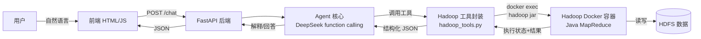

# MovieLens 数据分析 Agent —— 系统说明与交付文档（迭代一 + 迭代二）

> 对应课程要求：各迭代提交内容中的「相关文档」。
> 第 1-8 章为迭代一（Hadoop 数据清洗与五维评估），第 9 章起为迭代二
> （分类、聚类与降维分析）。涵盖：系统说明、运行方法、工具接口、
> 数据与版本、实验配置、评价结果、已知限制。

---

## 1. 系统概述

本系统是一个由 **Agent 驱动** 的 MovieLens 1M 数据治理系统。用户在前端输入自然语言请求，
Agent（基于 DeepSeek 大模型的 function calling）自动理解意图，调用 Hadoop MapReduce
工具完成 **数据检查 → 清洗前评分 → 数据清洗 → 清洗后评分 → 结果对照与解释** 的完整流程，
全程无需用户手动运行 Hadoop 命令、上传中间文件或逐阶段点击按钮。

### 1.1 技术栈

| 组件 | 选型 | 说明 |
| --- | --- | --- |
| 大数据框架 | Hadoop 3.4.1 | Docker 容器，单节点伪分布式 |
| 计算引擎 | Java MapReduce | Maven 构建，编译 target 1.8 |
| Agent | DeepSeek API（function calling） | OpenAI 兼容接口 |
| 后端 | FastAPI（Python 3.13） | 托管前端 + /chat 等接口 |
| 前端 | 原生 HTML/JS + Chart.js + marked | 无构建步骤 |
| 数据 | ml-1m | movies / ratings / users 三表 |

### 1.2 总体架构



---

## 2. 运行方法

详见项目根目录 `README.md` 第 4 节「快速开始」。核心步骤：

```powershell
# ① 打开 Docker Desktop，等就绪
# ② 项目根目录启动 Hadoop：
docker-compose up -d
# ③ 启动后端（自动定位 Python 与项目目录）：
powershell -ExecutionPolicy Bypass -File scripts\start-backend.ps1
# ④ 浏览器打开 http://127.0.0.1:8000/
```

前置条件：`config/secrets.env` 中已配置 `DEEPSEEK_API_KEY`。
首次使用需：`pip install -r requirements.txt`、编译 jar（`mvn package`）、上传原始数据到 HDFS。
完整初始化流程见 README 4.0 节。

---

## 3. 工具接口说明

Agent 通过 function calling 暴露以下工具，均为「封装 Hadoop 能力」的可调用接口：

| 工具 | 参数 | 功能 | 对应 MapReduce |
| --- | --- | --- | --- |
| `score_data` | `input_path`, `output_path` | 对数据做五维质量评分，返回得分+计数 | `lab2.ScoreJob` |
| `clean_data` | `input_path`, `output_path` | 清洗（修复/去重/隔离），返回处置统计 | `lab2.CleanJob` |
| `read_quarantine_samples` | `output_path`, `limit` | 读取隔离记录样例 | （读 HDFS） |

### 3.1 工具实现机制

每个工具内部通过 `subprocess` 执行 `docker exec lab2-hadoop sh -c "hadoop jar ..."`，
触发容器内的 MapReduce 作业，再从 HDFS 读回结构化 JSON。**Agent 不直接接触数据，
清洗与评分实际由 Hadoop 执行**，满足题目要求。

### 3.2 MapReduce 作业

| 类 | 职责 |
| --- | --- |
| `DataRules` | 共享规则：合法编码集、时间戳范围、T1/T2、字段判定 |
| `ReferenceTables` | 加载合法 ID 集合，用于跨表一致性检查 |
| `ScoreJob` | 五维评分（计数作业 + 去重作业），输出 `report.json` |
| `CleanJob` | 清洗（修复/去重/隔离），输出分目录数据 + `summary.json` |

### 3.3 后端 HTTP 接口

| 端点 | 方法 | 说明 |
| --- | --- | --- |
| `/chat` | POST | 自然语言请求，返回 Agent 回答 + 工具调用步骤 + **task_id** |
| `/health` | GET | 健康检查 + key 配置状态 |
| `/report` | GET | 完整评估报告（评分/统计/版本/T1T2） |
| `/samples` | GET | 清洗后数据样例 + 隔离样例 + 记录数 |
| `/reports` | GET | 历史报告文件名列表 |
| `/report-file/{filename}` | GET | 单个历史报告的完整内容 |
| `/` | GET | 前端页面 |

### 3.4 任务标识与报告归档

- 每次 `/chat` 请求生成唯一 **task_id**（UUID），随响应返回并在前端展示；
- 任务完成后，完整报告**自动归档**到本地 `reports/task-<id>-<时间戳>.json`，实现历史留存与追溯；
- 版本信息（`raw/rules/scoring/timeboundary`）从 `config/version.json` 读取，规则变更时改配置文件即可递增版本号，无需改代码。

---

## 4. 数据与版本管理

### 4.1 数据规模

| 文件 | 声明规模 | 实际行数（含注入脏数据） |
| --- | --- | --- |
| ratings.dat | 1,000,209 | 1,150,241 |
| users.dat | 6,040 | 6,946 |
| movies.dat | 3,883 | 4,465 |

> 实际文件被人为注入了约 15 万条脏数据，这正是本系统需要清洗的对象。

### 4.2 版本信息

| 产物 | 版本号 |
| --- | --- |
| 原始数据 | `raw-v1.0` |
| 清洗后数据 | `cleaned-v1.0` |
| 清洗规则 | `rules-v1.0` |
| 评分配置 | `scoring-v1.0` |
| 时间边界 | `timeboundary-v1.0` |

版本信息随评估报告（`/report`）一并输出，供后续迭代复用。

### 4.3 时间边界 T1/T2

| 边界 | 取值 | 时间戳（UTC 秒） | 用途 |
| --- | --- | --- | --- |
| T1 | 2000-12-31 23:59:59 | 978307199 | 训练期截止 |
| T2 | 2001-12-31 23:59:59 | 1009843199 | 验证期截止 |

T2 之后为测试期。后续迭代不得混用不同时间段的数据构造训练输入。

---

## 5. 实验配置

### 5.1 五维评分方案（scoring-v1.0）

统一口径：每维 0–100 分，清洗前后用**完全相同**的公式，保证可比。

| 维度 | 衡量定义 | 公式 |
| --- | --- | --- |
| Accurate | 字段值是否真实合法 | 合法记录数 / 总记录数 × 100 |
| Complete | 必填字段是否非空 | 非空字段数 / 应存在字段总数 × 100 |
| Unique | 业务记录是否唯一 | (1 − 重复记录数 / 总记录数) × 100 |
| Up-to-date | 时间戳是否在覆盖范围 | 合法时间戳记录 / 应有时效性记录 × 100 |
| Consistent | 格式/单位/跨表是否一致 | 一致记录数 / 总记录数 × 100 |

综合分 = 加权平均：Accurate 0.25、Complete 0.25、Unique 0.20、Consistent 0.20、Up-to-date 0.10。

**设计依据**：准确性/完整性直接决定可用性，权重最高；时效性受数据集本身年代限制（2003 年发布），改善空间有限，权重最低。

### 5.2 清洗规则（rules-v1.0）

三类处置：**修复（fix）**、**去重（dedup）**、**隔离（quarantine）**。

| 编号 | 问题 | 处置 |
| --- | --- | --- |
| R1 | 分隔符异常（逗号/竖线/冒号） | 修复为 `::` |
| R2 | 字段数错误 | 修复（丢弃 EXTRA_FIELD）或隔离 |
| R3 | 评分非整数/越界/空 | 隔离 |
| R4 | 时间戳毫秒级 | 修复（÷1000 转秒） |
| R5 | 时间戳超范围/非法 | 隔离 |
| R6 | 完全重复记录 | 去重 |
| R7 | 同键不同值冲突 | 隔离 |
| R8 | 编码非法（Gender=X、Age=30、Occ=99、UnknownGenre） | 隔离 |
| R9 | 空字段/空标题 | 隔离 |
| R10 | 跨表引用不存在 | 隔离 |
| R11 | 时间戳缺失 | 隔离 |
| R12 | 标题无年份/异常 | 隔离 |

---

## 6. 评价结果（真实运行结果）

### 6.1 五维评分对比

| 维度 | 清洗前 | 清洗后 | 变化 |
| --- | --- | --- | --- |
| Accurate | 94.12 | 100.0 | +5.88 |
| Complete | 97.65 | 100.0 | +2.35 |
| Unique | 92.04 | 100.0 | +7.96 |
| Up-to-date | 96.32 | 100.0 | +3.68 |
| Consistent | 96.43 | 100.0 | +3.57 |
| **Overall** | **95.27** | **100.0** | **+4.73** |

### 6.2 数据量变化（账目精确对平）

```
清洗前总量 1,161,652
  = 清洗后 1,005,855  (ratings 996,113 + users 5,895 + movies 3,847)
  + 隔离 155,503      (直接隔离 104,987 + 冲突 50,516)
  + 去重 294          (完全重复，保留一条)
```

| 处置类型 | 条数 |
| --- | --- |
| 修复 (fix) | 9,897 |
| 去重 (dedup) | 294 |
| 隔离 (quarantine) | 104,987 |
| 冲突 (conflict) | 50,516 |

### 6.3 发现的主要脏数据类型

- 评分：`3.5`、`five`、`0`、`6`（非整数/越界）
- 时间戳：毫秒级（`978153540000`）、负值（`-1`）、超范围（`4102444800`）
- 分隔符：逗号、竖线、单冒号混用
- 编码：`Gender=X`、`Age=30`、`Occupation=99`、`UnknownGenre`
- 跨表：引用不存在的 UserID/MovieID

---

## 7. 已知限制

1. **隔离 ≠ 修复**：155,503 条隔离/冲突记录被移出主数据集单独存放，其数据问题本身未解决，待人工复核。
2. **满分是「幸存者偏差」**：清洗后五维满分，仅代表「在既定规则下、对保留记录」达标，主要贡献来自「剔除」而非「修好」。
3. **格式正确 ≠ 内容真实**：规则只能校验格式/范围/唯一性，无法判断评分是否真实反映用户偏好（如刷分、误点）。
4. **时效性受年代限制**：数据为历史数据集（2000–2003），Up-to-date 满分仅指「时间戳格式合规」，不代表反映当前状态。
5. **无多版本快照**：HDFS 只保留最新一份产物，历史版本需通过下载报告手动归档。
6. **冲突记录未裁决**：同键不同值的 50,516 条记录被标记但未判定哪条为真，需人工介入。
7. **用户属性未经核验**：`users.dat` 中年龄/职业等由用户自愿填写，格式合法不代表内容准确。

---

## 8. 提交内容清单

| 提交项 | 位置 | 状态 |
| --- | --- | --- |
| 源码（MapReduce/Agent/后端/前端/配置/脚本） | `src/`、`config/`、`scripts/`、`docker-compose.yml` | ✅ |
| 依赖清单 | `requirements.txt` | ✅ |
| Git 忽略规则 | `.gitignore` | ✅ |
| 后端启动脚本 | `scripts/start-backend.ps1` | ✅ |
| 系统说明与交付文档（本文件） | `docs/系统说明与交付文档.md` | ✅ |
| 问题日志 | `docs/问题日志.md` | ✅ |
| 方案定稿（评分/清洗/时间边界） | `docs/阶段1_*.md`、`docs/阶段7_*.md` | ✅ |
| 项目 README（运行方法） | `README.md` | ✅ |

> 注：`config/secrets.env`（含 API key）在 `.gitignore` 中，**不会**随仓库上传；已提供 `config/secrets.env.example` 作为模板。

---

# 迭代二：分类、聚类与降维分析

## 9. 迭代二系统概述

迭代二在迭代一成果（cleaned-v1.0 数据、T1/T2 时间边界、版本管理机制）之上，
新增三类分析能力：

| 任务 | 问题 | 算法（各 2 种，均封装为独立 Agent 工具） |
| --- | --- | --- |
| 分类 | 用户对电影是否会给出 ≥4 分评分 | 逻辑回归、决策树 CART |
| 聚类 | 按历史观影偏好划分可解释的用户群体 | K-Means、DBSCAN（支持噪声点标记） |
| 降维 | 压缩用户偏好画像并比较压缩前后聚类质量、信息保留与资源开销 | PCA、SVD（TruncatedSVD） |

架构要点：

- **计算封装进 Hadoop 容器**：自定义镜像 `lab2-hadoop-ml:1.0`（apache/hadoop:3.4.1 +
  Miniconda Python 3.10 + numpy/pandas/scipy/scikit-learn/matplotlib），
  数据经 HDFS 拉取（迭代一 cleaned 数据），训练/预测通过 `docker exec` 在容器内执行。
- **预训练 + 注册**：一次性训练流水线（`scripts/train-ml.ps1`）生成全部模型、
  坐标、群体摘要与指标，登记到 `ml-artifacts/registry.json`；Agent 工具只做
  预测与查询，**不现场训练**，只返回已登记的实际结果。
- **时间纪律**：画像与统计特征只用训练期(≤T1)；验证期(T1,T2] 选参；测试期(>T2)
  最终评价。分类 F1/F2 统计量只在训练期计算，验证/测试复用训练期统计量。

## 10. 迭代二运行方法

```powershell
# ① 启动（首次自动构建 lab2-hadoop-ml:1.0 镜像，约 5-10 分钟）
docker-compose up -d

# ② 一键预训练（约 5-15 分钟；前置：HDFS 已有 cleaned-v1.0 数据）
powershell -ExecutionPolicy Bypass -File scripts\train-ml.ps1

# ③ 启动后端
powershell -ExecutionPolicy Bypass -File scripts\start-backend.ps1

# ④ 浏览器 http://127.0.0.1:8000/ 顶部导航切换「分类预测 / 用户聚类 / 降维分析」
```

未预训练时，前端三类分区会提示"模型未登记"，查询返回明确状态（这是需求要求的
异常路径，可主动演示）。

## 11. 迭代二工具接口

### 11.1 Agent 工具（7 个，全部 docker exec 容器内查询脚本）

| 工具 | 参数 | 返回要点 |
| --- | --- | --- |
| classify_predict_logreg | user_id, movie_id, at_time(T1/T2 默认 T2) | 预测类别、正类概率、模型版本、参数、PR-AUC/F1 |
| classify_predict_dtree | 同上 | 同上 |
| cluster_query_kmeans | users（"42"/"1,2,3"/"1-100"）、k（可选，已登记 5-8） | 群体归属、群体摘要、版本、参数、指标 |
| cluster_query_dbscan | users、eps/min_samples（可选，已登记网格内） | 群体归属 + 噪声点标记 + 摘要 + 指标 |
| reduce_query_pca | dim（可选，已登记 2/10/20/50，默认 50） | 信息保留、资源开销、降维前后聚类对照、主要变化方向 |
| reduce_query_svd | 同上 | 同上 |
| ml_registry_status | 无 | 已登记模型清单与版本 |

异常路径：未知 ID、历史不足、未登记参数、模型缺失、前置数据缺失/版本不一致，
均返回明确状态说明，不生成占位结果。

### 11.2 后端 HTTP 接口（迭代二新增）

| 端点 | 方法 | 说明 |
| --- | --- | --- |
| /ml/registry | GET | 注册表全文（模型/版本/参数/指标） |
| /ml/overview | GET | 三类任务两算法对照总览（前端实验对照卡） |
| /ml/artifacts/{name} | GET | 读取产物文件（坐标 JSON/摘要/评价报告/散点 PNG，白名单+防越界） |

### 11.3 注册表与版本

版本号存 `config/version.json`（迭代二扩展 profile/class/clust/dim 七项）；
产物与指标存 `ml-artifacts/registry.json`，每条目含 artifact_id、task、algorithm、
version、data_version、selected_params、metrics、files、created_at。
每次 `/chat` 涉及机器学习分析时，注册表快照自动归档进 `reports/`。

## 12. 迭代二实验配置与评价结果

> 详细方案（选型依据/参数网格/口径）见 `docs/迭代二_方案定稿.md`，此处为真实运行结果。

### 12.1 数据切分

| 集合 | 条数 | 正类比例 |
| --- | --- | --- |
| 训练（≤T1） | 901,409 | 57.85% |
| 验证（(T1,T2]） | 67,310 | 54.97% |
| 测试（>T2） | 27,394 | （见评价报告） |

画像：6,004 用户 × 3,678 电影稀疏矩阵。

### 12.2 分类结果（2026-10-19）

| 算法 | 最优参数 | 验证 PR-AUC/F1 | 测试 PR-AUC/F1 | 测试准确率 |
| --- | --- | --- | --- | --- |
| 逻辑回归 | C=0.1, balanced | 0.7248 / 0.6866 | 0.6834 / 0.6666 | 0.6290 |
| 决策树 | depth=None, leaf=50, balanced | 0.7280 / 0.6929 | **0.6950 / 0.6868** | 0.6530 |

Top 特征：LR = Documentary(+0.99)/用户均分(+0.75)/电影热度(+0.51)；
DT = 用户均分(52.5%)/电影热度(27.3%)。测试集 648 条冷启动用户事件、46 条冷启动电影事件、
1,116 条人口属性隔离事件均按既定口径处理并标注。

### 12.3 聚类结果（2026-10-19）

- **KMeans**：验证集选 k=5（轮廓 0.0146），训练群体规模 482/1198/1067/1162/2095，
  群体摘要含均分（3.5-3.6）、类型偏好（Film-Noir/War/Documentary 等）与代表电影；
- **DBSCAN**：选 eps=0.7129、min_samples=5（验证集 3 簇、噪声 48.9%），训练期主簇
  5,788 人 + 216 噪声点（3.6%）；测试期 6 簇、噪声 83.3%。
- 高维余弦空间轮廓系数整体偏低属数据特性，如实报告（详见方案定稿 3.5）。

### 12.4 降维结果（2026-10-19）

- **信息保留（50 维）**：PCA 方差解释率 40.6%、重构误差 0.7704；SVD 40.6%、0.7174；
  各维数（2/10/20/50）完整数据见方案定稿 4.6。
- **资源开销（50 维）**：PCA 3.25s / SVD 2.74s；峰值内存 965MB（中心化稠密矩阵）；
  坐标存储 1.123MB（原始矩阵 1.701MB）。
- **降维前后聚类对照**：KMeans 轮廓 0.0177（原始）→ 0.2515（PCA-50）/ 0.1509（SVD-50）；
  DBSCAN 噪声 3.6%（原始）→ 0%（降维坐标，距离收缩连为单簇）。
- **主要变化方向**：PC1 高载荷为 Star Wars / Raiders of the Lost Ark / Terminator
  等主流大片，解释为"大众电影偏好"方向。

## 13. 迭代二已知限制

见 `docs/迭代二_方案定稿.md` 第 7 节：迭代一隔离遗留（109 用户 / 86 电影属性缺失，
已标注处理）、DBSCAN 对表示敏感、聚类为统计分组、冷启动全局估计、降维信息有损、
模型不增量更新。

## 14. 迭代二提交内容清单

| 提交项 | 位置 |
| --- | --- |
| 机器学习脚本（训练/查询/注册） | `src/ml/`（Dockerfile + 11 个 py） |
| Agent 工具封装 | `src/agent/ml_tools.py` + `agent.py` 工具定义与提示词 |
| 后端端点 | `src/backend/main.py`（/ml/*） |
| 前端四分区 | `src/frontend/index.html` |
| 一键预训练脚本 | `scripts/train-ml.ps1` |
| 容器编排 | `docker-compose.yml`（构建 lab2-hadoop-ml:1.0） |
| 版本配置 | `config/version.json`（迭代二 7 项版本） |
| 方案定稿文档 | `docs/迭代二_方案定稿.md` |
| 系统说明与交付文档（本文件） | `docs/系统说明与交付文档.md` |
| 运行方法 | `README.md` |
